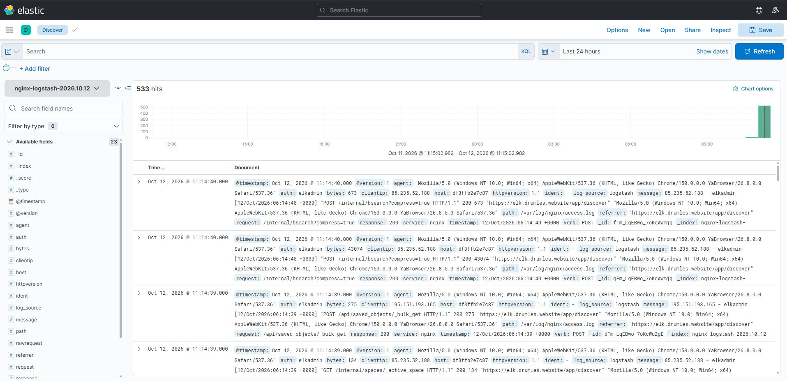
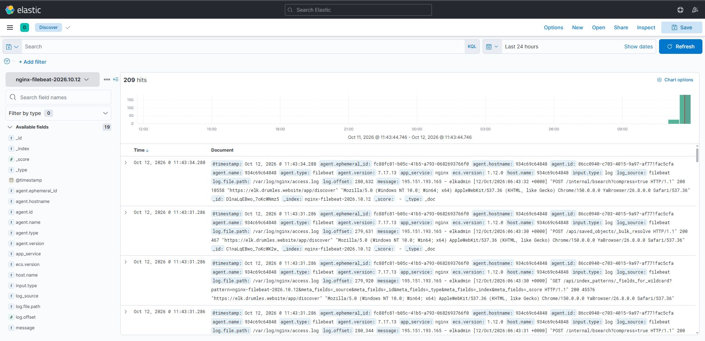

# Домашнее задание к занятию «ELK Stack»

---

### Задание 1. Развёртывание Elasticsearch и Kibana

Развёрнут стек ELK с использованием Docker Compose.

В состав решения входят:

- **Elasticsearch 7.17.13** — хранение и поиск логов.
- **Kibana** — просмотр и анализ логов.
- **Nginx** — доступ к Kibana по HTTPS с авторизацией Basic Auth.

Имя кластера Elasticsearch: `levykin-elk-cluster`.

Основные действия:

1. Подготовлен файл `elk/docker-compose.yml` для запуска компонентов стека.
2. Настроены параметры Elasticsearch и Kibana.
3. Настроен HTTPS-доступ к Kibana через Nginx.
4. Настроена базовая HTTP-аутентификация для доступа к веб-интерфейсу.
5. Проверен запуск контейнеров и доступность веб-интерфейса Kibana.

Команды для проверки:

```bash
cd ~/levykinda_sflt4

docker compose -f elk/docker-compose.yml ps

docker compose -f elk/docker-compose.yml logs --tail=100
```

Веб-интерфейс Kibana:

[https://elk.drumles.website](https://elk.drumles.website)

---

### Задание 2. Сбор и обработка логов с помощью Logstash

Настроен сбор access-логов Nginx через Logstash.

Основные действия:

1. Создан pipeline Logstash для обработки access-логов Nginx.
2. Настроены источник логов, фильтрация и преобразование событий.
3. Настроена отправка обработанных событий в Elasticsearch.
4. Проверено появление документов в индексе `nginx-logstash-*`.
5. Результат работы проверен в Kibana.

Файл конфигурации pipeline:

`elk/logstash/pipeline/nginx.conf`

Для просмотра состояния сервисов и логов:

```bash
cd ~/levykinda_sflt4

docker compose -f elk/docker-compose.yml ps

docker compose -f elk/docker-compose.yml logs --tail=100 logstash
```

Результат обработки логов через Logstash:



---

### Задание 3. Сбор логов с помощью Filebeat

Настроен Filebeat для отправки access-логов Nginx непосредственно в Elasticsearch.

Основные действия:

1. Настроен источник логов Nginx.
2. Подготовлен конфигурационный файл Filebeat.
3. Настроено подключение к Elasticsearch.
4. Проверена отправка событий и появление документов в индексе `nginx-filebeat-*`.
5. Проверена доступность полученных данных в Kibana.

Файл конфигурации:

`elk/filebeat/filebeat.yml`

Команды для проверки:

```bash
cd ~/levykinda_sflt4

docker compose -f elk/docker-compose.yml ps

docker compose -f elk/docker-compose.yml logs --tail=100 filebeat
```

После проверки Logstash был остановлен, чтобы исключить параллельную отправку одних и тех же логов двумя настроенными способами во время демонстрации работы Filebeat.

Результат сбора логов через Filebeat:



---

### Задание 4. Просмотр и анализ логов в Kibana

Для проверки поступления данных использован интерфейс Kibana.

Основные действия:

1. Открыт интерфейс Kibana по HTTPS.
2. Создан Data View `nginx-filebeat-*`.
3. В разделе Discover проверено наличие документов из Elasticsearch.
4. Проверены поля и временные метки полученных событий.
5. Сохранён скриншот результата для подтверждения работоспособности цепочки сбора логов.

В результате настроена цепочка сбора и анализа логов:

```text
Nginx
  |
  +--> Logstash --> Elasticsearch --> Kibana
  |
  +--> Filebeat --------------------> Elasticsearch --> Kibana
```

Оба способа доставки логов были проверены. Скриншоты результатов находятся в каталоге `img/`.

---

### Структура решения

```text
levykinda_sflt4/
├── elk/
│   ├── docker-compose.yml
│   ├── logstash/
│   │   └── pipeline/
│   │       └── nginx.conf
│   └── filebeat/
│       └── filebeat.yml
├── img/
│   ├── nginx-logstash-2026.10.12.jpg
│   └── nginx-filebeat-2026.10.12.jpg
└── README.md
```

### Итог

Развёрнут ELK Stack, настроен доступ к Kibana по HTTPS с Basic Auth, проверена доставка access-логов Nginx через Logstash и Filebeat в Elasticsearch. Результаты доступны для просмотра в Kibana, конфигурационные файлы и скриншоты сохранены в репозитории GitHub.
